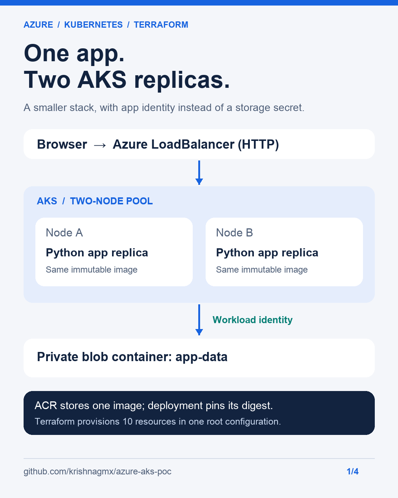

# Azure AKS · build, test, learn

A small, reproducible Azure Kubernetes project demonstrating Terraform,
container delivery, workload identity and rolling-update testing.

**Start here:** [Run it yourself](docs/SETUP.md) · [Technical case study](docs/CASE-STUDY.md) ·
[Recorded verification](evidence/live-2026-11-01/RESULT.md) · [LinkedIn kit](docs/LINKEDIN.md)



## What this demonstrates

| Engineering decision | Implementation and evidence |
| --- | --- |
| Keep only what the app needs | One Flask/Gunicorn image; removed the Node proxy and unused database, Key Vault and gateway |
| Reproducible infrastructure | One Terraform root configuration; 10 resources created; follow-up plan reported no changes |
| App authentication without a storage secret | AKS workload identity with blob access scoped to the private `app-data` container |
| Safer updates | Two replicas, health probes, graceful termination, disruption budget and digest-pinned deployments |
| Test the assumptions | A restart test exposed replica co-location; revision-aware spreading fixed it |
| Share the limits | HTTP demonstration endpoint, no zone redundancy, small-load tests rather than a capacity claim |

## Recorded results — November 1, 2026

| Check | Observed result |
| --- | --- |
| Functional | Page and items API passed; six blob round trips passed across two test runs |
| Final public sample | 100 health requests, concurrency 10, zero failures |
| Public latency | Median **306.7 ms**, p95 **448.1 ms** |
| Rolling restart after placement fix | **28 health checks, zero failures**; replicas on separate nodes |
| Final pod state | 2/2 Ready, zero restarts |
| Sampled pod usage | 47–59 millicores CPU, 99–102 MiB memory |
| Local tests | Seven application/rendering tests passed |

These are dated observations, not an uptime SLA or production capacity benchmark.
The first public run had a 3.8-second p95; that result is retained alongside the
later sample. [Read the methodology and limitations](docs/CASE-STUDY.md#verification-method).

The demo address recorded during testing was `http://4.236.11.192`. It may be
stopped to avoid ongoing cloud charges. Use the documented reproduction steps
instead of depending on that address.

## Run locally in a few commands

Requires Python 3.11+; no Azure account is needed for the page, API or mocked tests.

```sh
git clone https://github.com/krishnagmx/azure-aks-poc.git
cd azure-aks-poc
python3 -m venv .venv
source .venv/bin/activate
python -m pip install -r requirements-dev.txt
python -m unittest discover -s tests -v
python -m flask --app src/backend/app run
```

Open `http://127.0.0.1:5000`. A storage check returns 503 until Azure storage is
configured. See [Azure setup, verification and cleanup](docs/SETUP.md) for the full run.

## Repository map

```text
infrastructure/   AKS, ACR, blob storage and workload identity in Terraform
k8s/              namespace, service account, app, service and disruption budget
src/backend/      unified Python application, page and container build
scripts/          state bootstrap, deployment, manifest rendering and live checks
tests/            application and deployment-rendering tests
evidence/         recorded results (live-2026-11-01 is the current stack)
docs/             setup guide, case study, CI guide and LinkedIn visuals
```

GitHub Actions validates, tests and builds on pushes and pull requests. Cloud
deployment is **opt-in** after OIDC and repository variables are configured;
forking this repository does not automatically provision Azure resources.
[Configure CI/CD](docs/CI.md).

## Boundaries

AKS Free, ACR Basic and LRS storage keep the demonstration small. Two nodes cost
more than a single-node PoC, and the stack is not zone redundant. TLS, API access
control, WAF and centralized monitoring are future production requirements.
The sample write API is unauthenticated. Terraform state administration uses
storage keys; the application itself uses workload identity and no connection string.

The tested subscription had only four regional/DSv4 vCPUs: enough for two nodes,
but not a third node or an upgrade surge. Check your quotas before deploying.
Provisioning creates billable resources; follow the [cleanup steps](docs/SETUP.md#cleanup).

This PoC is intended as a transparent engineering work sample. For a recruiter
walkthrough and résumé wording, see [the case study](docs/CASE-STUDY.md#talking-about-the-project).
