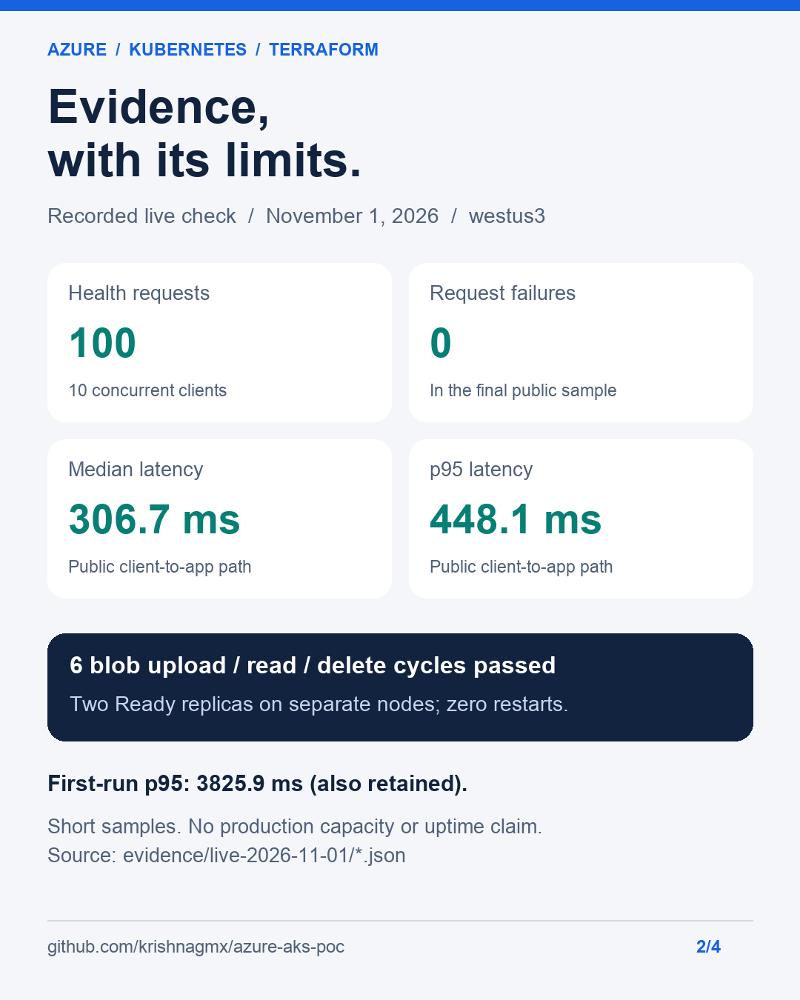

# Engineering case study: a smaller AKS stack, tested live

## Problem and scope

The initial repository described a two-container app plus PostgreSQL, Key Vault,
Application Gateway/WAF and custom network modules. Several components were not
used by the implemented page, items API or blob check. CI assumed deployments
already existed, image paths differed in case from tracked filenames, and
configuration referenced a previous deployment's resources.

The objective was to rebuild a small, understandable PoC and verify its behavior
in Azure. It is a personal engineering work sample, not a production platform or
an enterprise migration claim.

## Architecture and decisions

One Flask/Gunicorn image serves the HTML page and API. ACR stores the image;
Terraform provisions AKS, the registry, blob storage and a federated app identity.
A Kubernetes LoadBalancer exposes two app replicas. The app's managed identity has
Storage Blob Data Contributor access scoped to the private `app-data` container.
Deployment settings are read from Terraform outputs and images are pinned by digest.

| Choice | Why | Tradeoff |
| --- | --- | --- |
| Keep AKS | Demonstrate Kubernetes scheduling, identity, probes and rollouts | More infrastructure than this small app strictly needs; Container Apps could reduce operations |
| Remove the Node proxy | Serve the page and API from one origin/image | Independent frontend deployment is no longer demonstrated |
| Remove unused database/gateway/vault | Reduce dependencies, configuration and cost | No database integration, WAF or vault integration claim |
| Two nodes, two replicas | Exercise placement and rolling availability | Higher baseline cost than one node; no zone redundancy |
| Workload identity | Avoid an app storage connection-string secret | Requires correct federation, labels and RBAC propagation |
| Free AKS / Basic ACR / LRS | Keep the PoC small | No control-plane SLA or zone-redundant storage |

The application uses token-based storage access. The Terraform provider/backend
still accesses storage keys for administration; "secretless app authentication"
is not a claim that no credentials exist anywhere in the system.

## A bug the live test found

The first rolling restart passed 38 HTTP health checks without observed failures.
However, both replacement pods ended up on the same node. The original spread
rule counted old and new replicas together, so a successful rollout did not mean
the final replicas remained distributed.

The fix added `matchLabelKeys: [pod-template-hash]` to the hostname spread rule,
so each revision is spread independently. Probe timeouts were also increased to
three seconds to avoid an overly tight one-second deadline. A second restart
passed 28 health checks and the final replicas occupied separate nodes, with zero
container restarts. See [Kubernetes' topology-spread guidance](https://kubernetes.io/docs/concepts/scheduling-eviction/topology-spread-constraints/).

**Lesson:** check placement and observable behavior after a rollout, not just the
Deployment's success message. The revised [manifest](../k8s/app.yaml) is backed by
[recorded pod placement and rollout output](../evidence/live-2026-11-01/).

## Verification method

Recorded on November 1, 2026, in westus3. These samples are short and were not a
controlled maximum-capacity experiment. Public checks originate from the client;
network location, connection setup and cold effects influence latency.

| Sample | Method | Result |
| --- | --- | --- |
| First public run | 100 health requests; concurrency 10 | 0 failures; median 306.3 ms; p95 3825.9 ms |
| Final public run | Same request count and concurrency, after rollout fix | 0 failures; median 306.7 ms; p95 448.1 ms; 29.1 requests/s |
| In-pod localhost | 200 health requests; concurrency 10 | Median 9.48 ms; p95 33.19 ms; 709.3 requests/s |
| Blob | 3 upload/download/delete cycles per public run | 6 successful cycles total; no active test blobs remained |
| Corrected rolling restart | Public health requests while pods were replaced | 28 successful checks; no observed request failures |
| IaC | Apply, then refresh/plan | 10 created; subsequent plan reported no changes |
| Local tests | Python unittest app/rendering suite | 7 passed |

The localhost figure excludes public networking, the LoadBalancer and storage.
Do not compare it directly with the public request rate or claim it is production
throughput. The recorded summaries do not contain a per-request latency trace;
we therefore do not calculate confidence intervals or publish percentile histograms.
The initial high tail latency is retained, not hidden or attributed conclusively.

[Raw JSON and cluster snapshots](../evidence/live-2026-11-01/)
are the primary evidence. The visuals are generated from those recorded results;
they are not screenshots of Azure Portal, CI runs or dashboards. No successful
GitHub Actions deployment is claimed merely because the workflow exists.

## Limits and next steps

- The demonstration endpoint uses HTTP and its blob-write check is unauthenticated.
- The design is not zone redundant; voluntary disruption protection does not prove
  resilience to a node crash, zone outage or simultaneous failures.
- The tested subscription's four-vCPU quota leaves no room for a third node or
  an upgrade surge. Check/request quota before relying on those operations.
- Resource measurements are snapshots; no sustained saturation test was performed.
- A production follow-up would add TLS, API access control, monitoring/alerts,
  a budget, appropriate SLA/zonal choices, and tested recovery procedures.

## Talking about the project

### 45-second recruiter explanation

“I built and live-tested a small Azure Kubernetes PoC with Terraform and a Python
app. I simplified the original stack to one image and removed services the app
didn't use. The app accesses blob storage through workload identity instead of a
connection-string secret. I tested the public page/API, storage and rolling updates.
One useful finding was that a successful rollout still placed both replicas on one
node. I fixed the spread rule and verified separate-node placement after another
restart. The repository includes setup instructions, raw test evidence and the
limitations, so someone else can reproduce it.”

### Technical follow-up prompts

- Why AKS rather than Container Apps? Learning/portfolio scope; acknowledge the
  operational overhead for a small app.
- Why not depend on blob storage in liveness? A storage outage should not restart
  otherwise healthy web processes; storage is checked separately.
- Why digest pinning? A reused tag cannot silently change an already deployed image.
- What does the PDB prove? It constrains voluntary evictions; it is not an uptime SLA.
- What would you improve next? TLS/access control, observability, quota headroom,
  zonal availability and a recovery exercise.

### Résumé/project bullet

Built and live-tested a Terraform-managed Azure AKS PoC with a single Python image,
container-scoped workload identity and two-replica rolling updates; diagnosed and
fixed revision-aware pod placement, with reproducible tests and recorded evidence.

Use this as a project example. Do not describe it as production experience,
a certification, a production migration or proof of enterprise-scale throughput.
